<p align="center">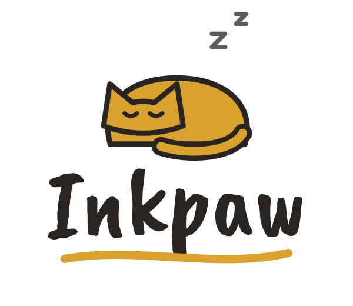</p>

<p align="center">
  <b>A modular Hyprland desktop written in Lua — themed from your wallpaper, configured from one Settings app, with a hand-drawn “encre” style.</b>
</p>

<p align="center">
  <a href="#install">Install</a> ·
  <a href="#features">Features</a> ·
  <a href="#screenshots">Screenshots</a> ·
  <a href="#first-steps">First steps</a> ·
  <a href="docs/">Documentation</a>
</p>

<p align="center">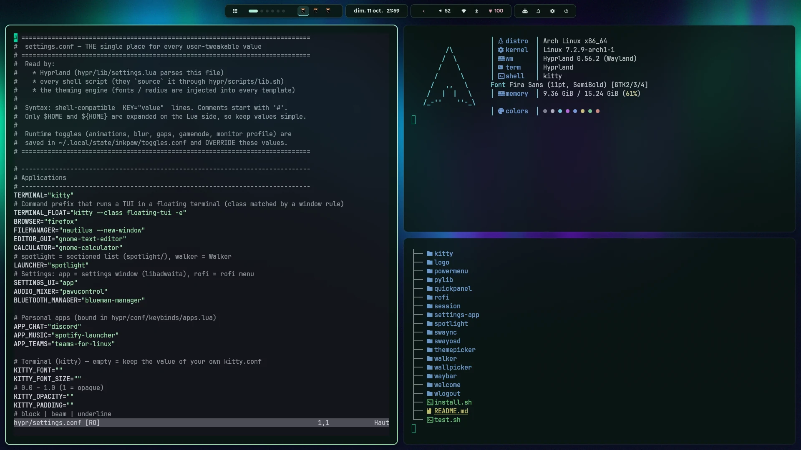</p>

---

**Inkpaw** (« patte d'encre », *ink paw*) is a complete Hyprland 0.56 desktop:
bar, launcher, notifications, lock screen, menus, quick settings panel, AI
assistant and a theming engine — every part modular, commented and driven by
one settings file. It runs as **its own login session**: your existing
`~/.config` and your usual Hyprland session are never touched.

## Install

On Arch Linux (or an Arch-based distribution), one command:

```bash
curl -fsSL https://raw.githubusercontent.com/Tataneeeeeeeeeee/Inkpaw/main/install.sh | bash
```

The installer asks before each step. It:

1. clones Inkpaw into `~/.local/share/inkpaw/repo`;
2. installs the missing packages with `yay` or `paru` (Hyprland, Waybar, swaync, matugen, Walker…);
3. uses your keyboard layout;
4. draws the procedural wallpapers into `~/Pictures/wallpapers`;
5. adds **“Hyprland — Inkpaw”** to the session menu of your login screen (`sudo`).

Then log out, pick **Hyprland — Inkpaw** on the login screen and log in. A
welcome window guides you through the first settings.

```bash
# options (after "bash -s --"): --yes  --sddm-theme  --no-deps  --no-wallpapers  --no-session  --dir DIR
curl -fsSL https://raw.githubusercontent.com/Tataneeeeeeeeeee/Inkpaw/main/install.sh | bash -s -- --sddm-theme
```

Prefer to read before running? Clone the repo and run `./install.sh` from it.
Manual installation, the dependency list and uninstalling are described in
[docs/installation.md](docs/installation.md).

## Features

- **Wallpaper → palette theming.** Pick a wallpaper and the whole desktop
  follows: Hyprland borders, Waybar, launcher, menus, notifications, OSD, lock
  screen, terminal, GTK 3/4 apps and Firefox (pywalfox). Powered by matugen,
  with light/dark switching and nine static themes (Catppuccin, Tokyo Night,
  Rosé Pine, Nord, Gruvbox, Synthwave '84…).
- **One Settings app.** A GTK 4 / libadwaita window for every option — bar
  layout and modules, fonts, gaps, borders, animations, monitors, keyboard,
  default apps, AI provider. Changes apply live and can be reset per row.
- **A generated bar.** Waybar's config is built from a few settings: position,
  layout, style (capsules, floating, solid, minimal, HyDE-like, encre) and the
  modules of each capsule.
- **Spotlight.** A sectioned search: apps, calculator, files, emoji, clipboard,
  web and maps, desktop actions, commands.
- **Quick panel.** Wi-Fi, Bluetooth, sound per app, brightness (DDC/CI for
  external screens, night light), battery and power mode, notifications history,
  calendar and media — drop-downs from the bar icons, open instantly.
- **AI assistant.** A side window that docks next to your tiled windows, with
  conversations and full Markdown. Claude by default, or any OpenAI-compatible
  API (OpenAI, Ollama, OpenRouter…).
- **The “encre” style.** An optional hand-drawn look: parchment panels, ink
  outlines, brush titles and a litter of original cats in the menus, the
  cheat sheet, the theme and wallpaper selectors, the lock and login screens.
- **Modular by design.** One concern per file, every file commented, every
  value in `hypr/settings.conf`. Turn a module off by commenting one line.
- **Tested.** `./test.sh verify` checks the Hyprland config on every monitor
  profile, every JSON/TOML/rofi/shell file, and renders every theme — in a
  throw-away copy, never in your config.

## Screenshots

All taken with the default look; the colors come from the wallpaper (“aurora north”, drawn by `hyprtheme/generate-wallpapers.sh`).

| | |
|---|---|
| 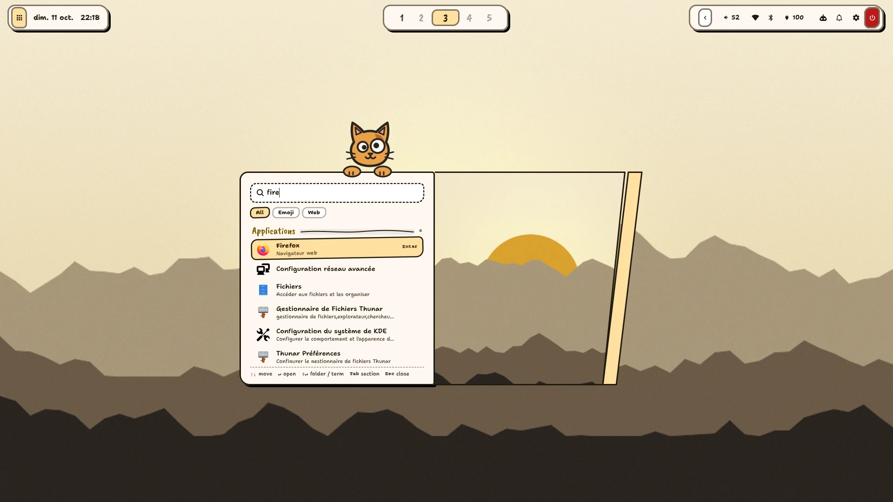<br>**Spotlight** — apps, calculator, web, emoji, actions (`SUPER+SPACE`) | 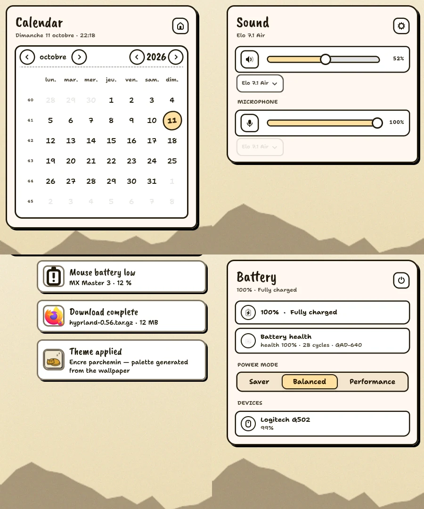<br>**Quick panel** — calendar, sound, battery and notifications, from the bar icons |
| 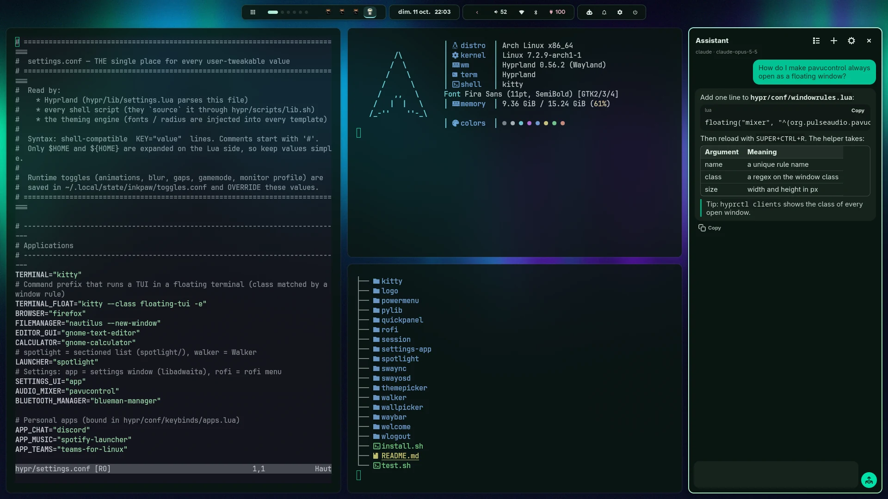<br>**AI assistant** — docks beside your windows, full Markdown (`SUPER+I`) | 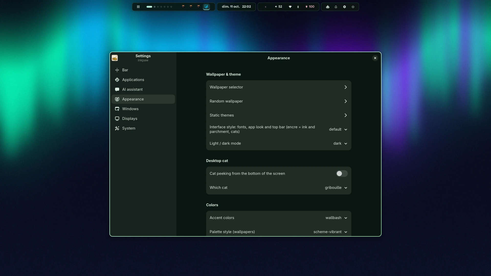<br>**Settings** — every option, applied live (`SUPER+CTRL+S`) |
| 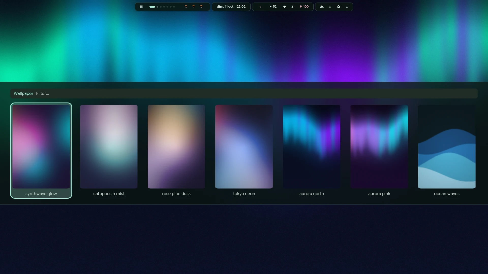<br>**Wallpaper selector** — the palette follows (`SUPER+CTRL+W`) | 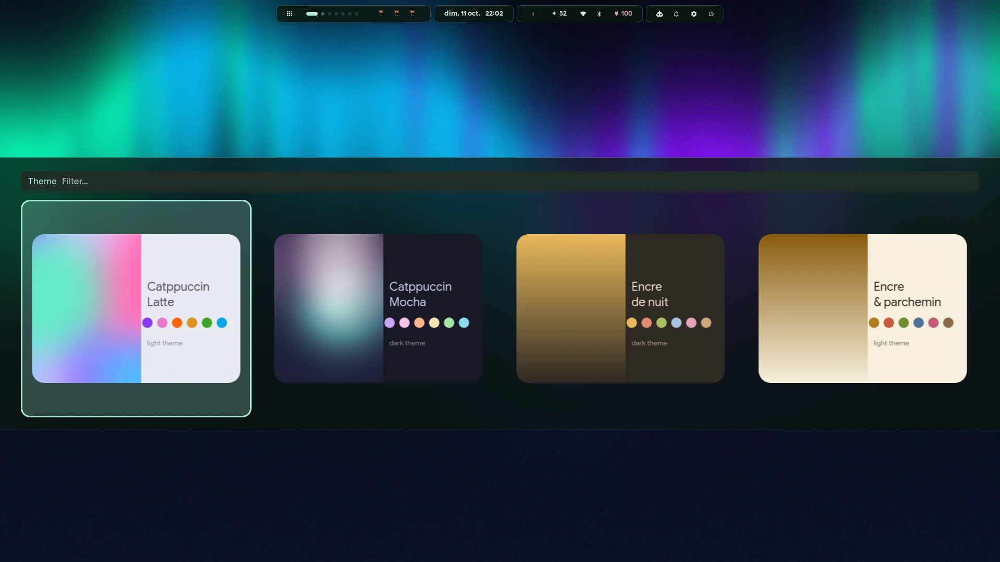<br>**Static themes** — Catppuccin, Tokyo Night, Nord, Encre… (`CTRL+ALT+T`) |
| 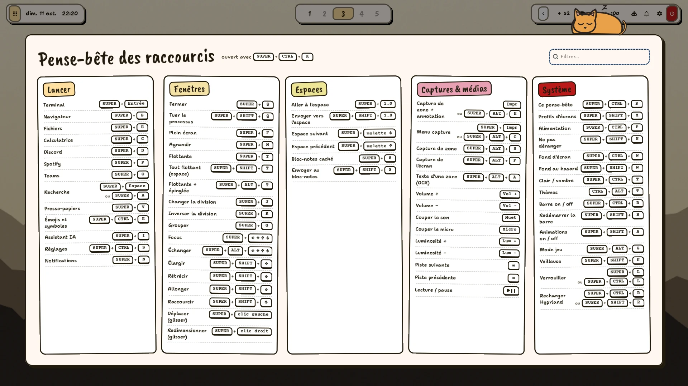<br>**Cheat sheet** — every shortcut, searchable (`SUPER+CTRL+K`) | 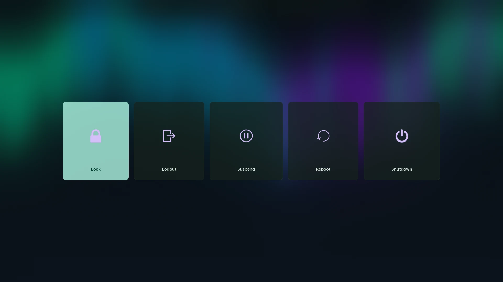<br>**Power menu** (`SUPER+CTRL+P`) |
| 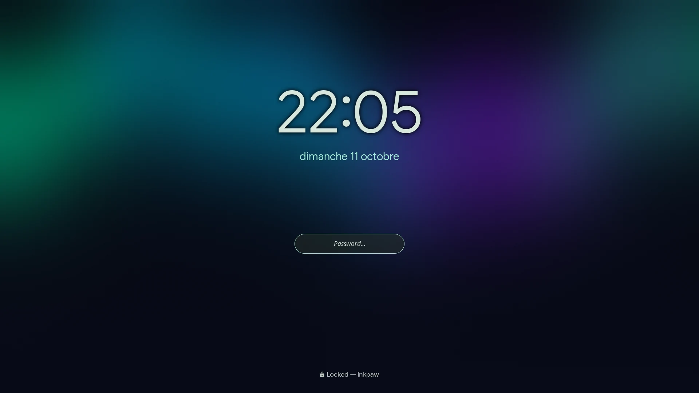<br>**Lock screen** — hyprlock in the theme colors | 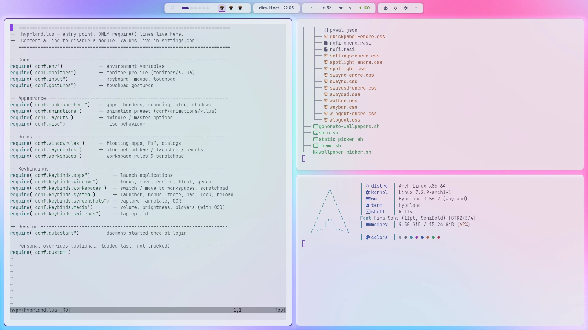<br>**Light themes** — `SUPER+CTRL+T` switches light ↔ dark |

## First steps

| Keys | Action |
|---|---|
| `SUPER+SPACE` | Spotlight search |
| `SUPER+RETURN` | terminal |
| `SUPER+CTRL+S` | Settings |
| `SUPER+CTRL+K` | every shortcut, searchable |
| `SUPER+CTRL+W` / `CTRL+ALT+T` | wallpaper / static theme |
| `SUPER+CTRL+T` | light ↔ dark |
| `SUPER+I` | AI assistant |
| `SUPER+N` | notifications |
| `SUPER+CTRL+P` | power menu |
| `PRINT` or `SUPER+ALT+E` | screenshot an area and annotate it |

The full list is in [docs/keybindings.md](docs/keybindings.md). Every option of
Settings is also a line in `hypr/settings.conf` — see
[docs/configuration.md](docs/configuration.md).

## Documentation

| | |
|---|---|
| [Installation](docs/installation.md) | one-line and manual install, dependencies, the login session, uninstall, troubleshooting |
| [Configuration](docs/configuration.md) | where values live, the Settings app, Hyprland modules, monitors, apps |
| [Theming](docs/theming.md) | the theme engine, static themes, wallpapers, accents, the “encre” style |
| [Bar](docs/bar.md) | the generated Waybar: settings, modules, clicks |
| [Apps](docs/apps.md) | Spotlight, quick panel, notifications, AI assistant, menus, desktop cat |
| [Keybindings](docs/keybindings.md) | every shortcut |
| [Development](docs/development.md) | project layout, tests, adding a module / theme / bar style |

## Requirements

Arch Linux or an Arch-based distribution, **Hyprland 0.56+** (Lua config) and a
display manager that reads Wayland sessions (SDDM, GDM, ly…). `./test.sh deps`
lists what is missing and prints the command to install it.

## Credits

- Fonts bundled for the “encre” style: [Shantell Sans](https://github.com/arrowtype/shantell-sans),
  [Caveat Brush](https://fonts.google.com/specimen/Caveat+Brush) and
  [Courier Prime](https://quoteunquoteapps.com/courierprime/), all under the SIL Open Font License
  (licenses next to the fonts in `hyprtheme/fonts/`).
- The cats, the logo and the wallpapers are drawn by scripts of this repo
  (`hyprtheme/skins/encre/cats/build.py`, `logo/build.py`, `hyprtheme/generate-wallpapers.sh`).
- Built on [Hyprland](https://hyprland.org), [Waybar](https://github.com/Alexays/Waybar),
  [matugen](https://github.com/InioX/matugen), [Walker](https://github.com/abenz1267/walker),
  [SwayNotificationCenter](https://github.com/ErikReider/SwayNotificationCenter) and friends.
  The bar layout was inspired by ML4W and the menus by HyDE.
